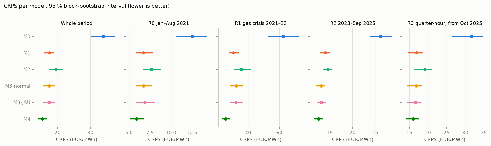
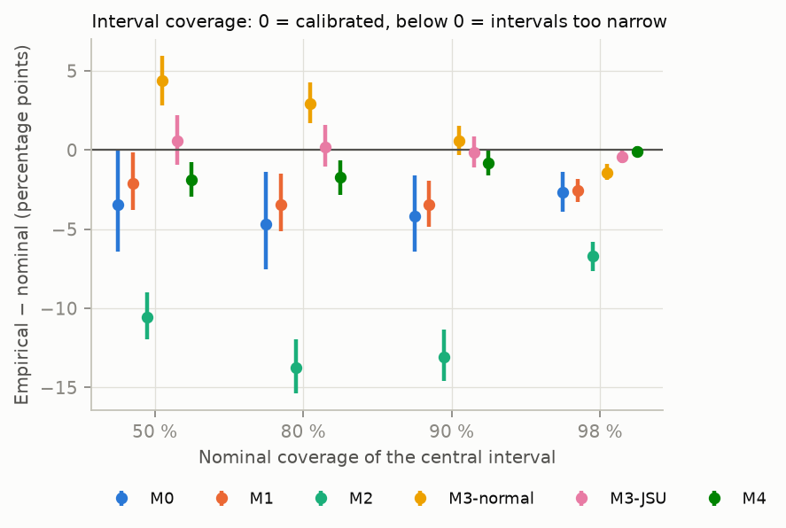
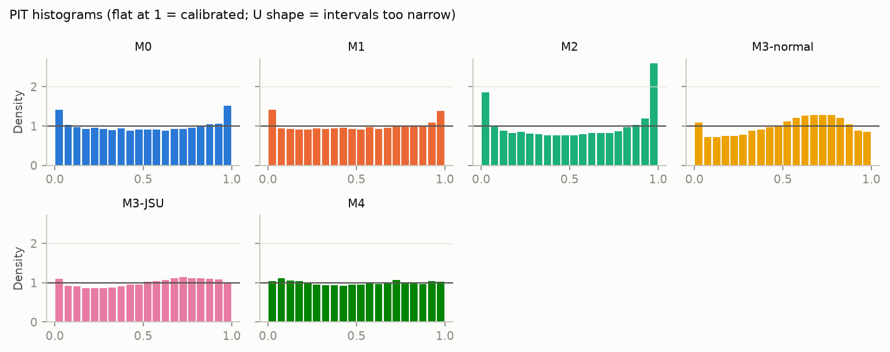
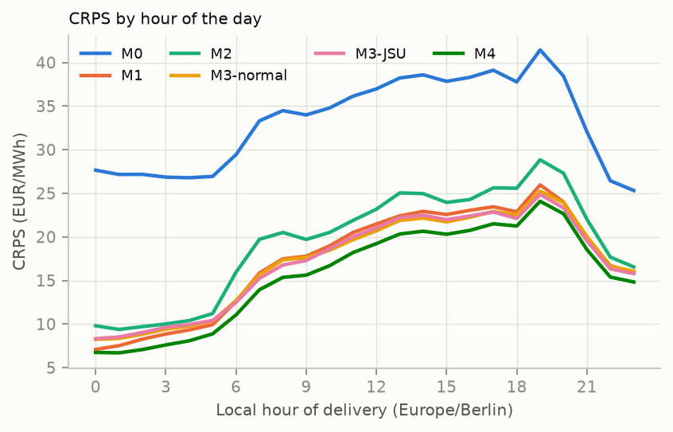
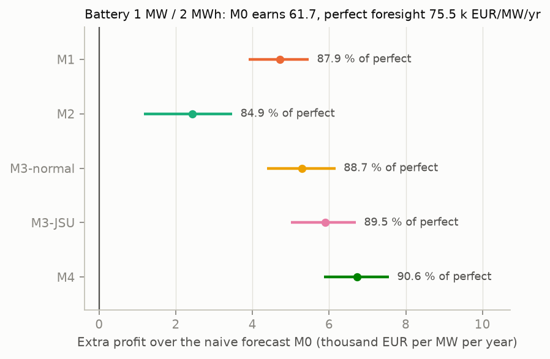

# powercast

Probabilistic forecasts of German day-ahead electricity prices, made every morning before
the auction closes, scored against the real prices.

Every day the day-ahead auction for the German–Luxembourg bidding zone (DE-LU) closes at
12:00 Berlin time and fixes the electricity price of each interval of the next day, called
a market time unit (MTU): one hour before 1 October 2025, 15 minutes since then. This
project forecasts the full probability distribution of every one of those prices, using
only information that was public before the auction closed.

The project asks three questions, answered on a test period of almost six years
(January 2021 – October 2026) that no model or setting saw during development:

1. **Which forecasts are closest to the truth?** Scored with the continuous ranked
   probability score (CRPS) and checked for calibration: does an 80 % interval contain
   the real price 80 % of the time?
2. **Do complex models beat simple ones?** A naive rule, a linear benchmark and
   gradient-boosted trees against a distributional neural network and a pretrained
   time-series foundation model.
3. **Does a better forecast earn more money?** A simulated battery that trades on each
   forecast, profit in euros per year.

## Answers in short

1. **A pretrained foundation model, used without any training on this market, gives the
   best forecasts.** Chronos-2 has a CRPS of 15.4 €/MWh on the test period, 12 % below
   the best classical model (LEAR with quantile regression, 17.5 €/MWh), and wins in every
   market period, including the year after its weights were published.
2. **The distributional neural network does not beat the linear benchmark** on the test
   period (17.4 vs 17.5 €/MWh, Diebold–Mariano p = 0.4), although it did on validation.
   Gradient-boosted trees are the weakest learned model and badly overconfident.
3. **Yes, a better forecast earns more.** A 1 MW / 2 MWh battery scheduled on Chronos-2
   earns 6 700 €/MW/yr more than on the naive forecast (90.6 % of the perfect-foresight
   profit, against 81.7 %), and 2 000 €/MW/yr more than on LEAR.

## The forecast

For delivery day D the forecast is issued at **11:00 Berlin time on day D−1** and gives,
for every MTU of D, the quantiles of the price at the 99 levels τ = 0.01, 0.02, …, 0.99.
The published forecast is that of Chronos-2 (M4), the best model on the test period;
the naive forecast (M0) and LEAR-QRA (M1) run alongside for comparison.
A new forecast is published every morning by a scheduled GitHub Actions job
(`.github/workflows/daily.yml`) in [`forecasts/live/`](forecasts/live/), together with
the running score of all past live forecasts against the real prices (`track_record.csv`).

## Data

| Series | Source | Resolution | Period |
|---|---|---|---|
| Day-ahead price DE-LU (DE-AT-LU before Oct 2018) | SMARD | 60 min, 15 min from Oct 2025 | Jan 2015 – today |
| Grid operators' day-ahead forecasts of load, wind onshore, wind offshore, solar | SMARD | 15 min | Jan 2015 – today |
| Measured load, wind, solar (cross-check only) | SMARD, Energy-Charts | 15 min | Jan 2015 – today |

SMARD and Energy-Charts agree exactly on all 134 163 common price timestamps; prices
missing on SMARD (20–21 Nov 2026) are taken from Energy-Charts and marked. Raw files are
kept as dated, unmodified copies. Daylight-saving days (23 and 25 hours), gaps and
duplicates are checked automatically (`results/data_checks/`).

No free, reusable daily source of gas or CO₂ prices was found, so the models do not use
fuel prices (see `docs/DECISIONS.md`, D2.4).

## No look-ahead

A backtest is only honest if every model sees exactly what was public at the issue
time. Each input has a publication rule, measured by polling both sources every five
minutes on 23 Nov 2026 (`scripts/probe_publication_times.py`):

| Input | Public at |
|---|---|
| Price of day D | D−1, ≈ 12:45 (after the auction) |
| Load forecast for D | D−1, before 10:15 |
| Wind and solar forecasts for D | D−1, **after 12:00** (not yet public at the auction) |
| Measured values | ≈ 2 h after the interval ends |

So the models use the load forecast for D but the wind and solar forecasts only for D−1
and D−2. Many published benchmarks use the wind and solar forecasts for D; on SMARD these
appear only after the auction, so a model using them could not be run in real time.

`powercast.nopeek.assert_no_peeking` enforces the rules: it replaces every value
published after the issue time with random noise and fails if the model's inputs change.
It runs before every training and forecasting run, on the exact data handed to the
model.

## Method

| ID | Model | Class |
|---|---|---|
| M0 | Naive: price of the same hour one week earlier, plus the empirical quantiles of this rule's errors over the last 364 days | simple |
| M1 | LEAR-QRA: LASSO-estimated autoregressive models (Lago et al. 2021) on 4 training windows, combined by quantile regression (Nowotarski & Weron 2015) | simple |
| M2 | LightGBM gradient-boosted trees with quantile loss | simple |
| M3 | Distributional neural network (Marcjasz et al. 2023), normal and Johnson's SU outputs, 5 random seeds | complex |
| M4 | Chronos-2, a pretrained time-series foundation model, used without retraining | complex |

All models forecast the 24 hourly prices of D. From October 2025 the 96 quarter-hour
prices are obtained by one shared layer that adds the within-hour pattern, predicted from
the within-hour shape of the forecast residual load (load − wind − solar), so model
differences after October 2025 come from the hourly forecasts.

The full evaluation protocol was written before any model was trained:
[`docs/EVALUATION_PLAN.md`](docs/EVALUATION_PLAN.md). In short:

- **Periods:** training from 2015; validation 2019–2020 (all tuning and choices);
  test 2021-01-01 – 2026-10-31, run once with frozen settings, split into four market
  periods: R0 before the gas crisis, R1 gas crisis (Sep 2021 – Dec 2022), R2 after the
  crisis, R3 quarter-hour prices (from Oct 2025).
- **Rolling forward as in real use:** each day is forecast from data before it; models
  are refitted daily (M0, M1) or weekly (M2, M3).
- **Scores:** CRPS, the mean pinball loss over the 99 quantile levels, in €/MWh (for a
  point forecast it equals the absolute error); MAE of the median; coverage of the
  central 50, 80, 90 and 98 % intervals; PIT histograms (the rank of the real price
  within the forecast distribution, flat if calibrated). Spikes and negative prices are
  kept and also scored separately.
- **Error bars:** 95 % intervals from a moving-block bootstrap over days (14-day
  blocks); Diebold–Mariano tests before claiming that one model beats another.
- **Battery:** 1 MW / 2 MWh, 90 % round-trip efficiency, at most one cycle per day,
  scheduled by a linear programme on the forecast mean price and paid the real prices.

Every design choice, with the options considered and the evidence, is in
[`docs/DECISIONS.md`](docs/DECISIONS.md); the lab notebook is [`docs/LOG.md`](docs/LOG.md).

## Results

Test period 2021-01-01 – 2026-10-31 (2 130 days, 79 635 prices), run once with settings
frozen on validation. Intervals are 95 % moving-block bootstrap intervals over days. All
tables are produced by `scripts/report.py` from `results/` (full version:
[`results/report_test.md`](results/report_test.md)).

**Terms.** *CRPS* (continuous ranked probability score): the mean pinball loss over the
99 quantiles, in €/MWh; it rewards forecasts that are both sharp and correct, and equals
the absolute error for a point forecast. *Coverage*: the share of real prices inside
the central 80 % interval of the forecast (calibrated: 80 %). *Diebold–Mariano test*:
a paired test on the daily score differences of two models.

| Model | CRPS (€/MWh) | MAE of median (€/MWh) | Coverage 50 / 80 / 90 / 98 % |
|---|---|---|---|
| M0 naive | 33.93 [30.08, 37.62] | 43.46 [38.50, 48.30] | 46.5 / 75.3 / 85.8 / 95.3 |
| M1 LEAR-QRA | 17.49 [15.91, 19.00] | 23.26 [21.18, 25.24] | 47.9 / 76.6 / 86.5 / 95.4 |
| M2 LightGBM | 19.44 [17.32, 21.60] | 25.69 [22.96, 28.38] | 39.4 / 66.2 / 76.9 / 91.3 |
| M3 network, normal | 17.43 [15.61, 19.24] | 23.64 [21.09, 26.21] | 54.4 / 82.9 / 90.6 / 96.6 |
| M3 network, JSU | 17.42 [15.60, 19.20] | 23.36 [20.89, 25.76] | 50.6 / 80.2 / 89.8 / 97.6 |
| **M4 Chronos-2** | **15.42** [14.05, 16.75] | **20.99** [19.11, 22.84] | 48.1 / 78.3 / 89.2 / 97.9 |

The intervals of different models overlap because all models share the same hard days
(the 2022 gas crisis dominates). The paired Diebold–Mariano test removes that shared
variation: M4 beats every other model (p < 0.001); M1 and both M3 are indistinguishable
(p ≥ 0.37); all beat M0 (p < 0.001).



| Model | R0 Jan–Aug 2021 | R1 gas crisis Sep 2021–Dec 2022 | R2 2023–Sep 2025 | R3 15-min, Oct 2025–Oct 2026 |
|---|---|---|---|---|
| M0 | 12.51 [10.60, 14.33] | 62.38 [52.71, 72.88] | 26.19 [23.87, 28.59] | 31.69 [26.45, 34.92] |
| M1 | 6.71 [5.78, 7.82] | 30.50 [27.88, 33.95] | 13.98 [12.91, 14.97] | 16.98 [14.71, 18.63] |
| M2 | 7.66 [6.62, 8.83] | 35.63 [30.94, 41.77] | 14.57 [13.44, 15.59] | 19.12 [16.24, 21.11] |
| M3 normal | 6.74 [5.80, 7.79] | 32.32 [28.57, 37.03] | 13.06 [12.00, 14.02] | 16.75 [14.44, 18.47] |
| M3 JSU | 6.87 [5.88, 8.16] | 32.14 [28.58, 36.56] | 13.14 [12.08, 14.14] | 16.62 [14.30, 18.22] |
| M4 | **5.90** [5.13, 6.73] | **25.59** [23.30, 28.65] | **12.55** [11.55, 13.55] | **16.03** [14.13, 17.70] |

The network beats LEAR after the crisis (R2, p < 0.001) but loses during it (R1,
p = 0.03 for JSU). A plausible reason, not tested here: the network is refitted weekly
on three years dominated by calm prices, while LEAR is refitted daily and includes a
short 56-day window that follows a new price level quickly.

**Calibration.** Chronos-2 and the JSU network are close to calibrated at every level;
LightGBM's intervals are much too narrow (66 % instead of 80 %), the naive and LEAR
forecasts slightly so.




The PIT histogram is the distribution of the forecast's cumulative probability at the
real price: flat if calibrated; peaks at both ends mean too-narrow intervals (M2);
a hump means too-wide or shifted ones (M3 normal).

**Spikes and negative prices** are kept in every score and scored separately: on the
prices above the previous year's 99th percentile, the 80 % interval of the best models
holds only 50–60 % of them; LightGBM's holds 13 %. Details in `results/report_test.md`.

**Time of day.** All models are worst in the evening peak (19:00) and best at night.



**Battery.** A 1 MW / 2 MWh battery (90 % round-trip efficiency, one cycle per day)
is scheduled each day by a linear programme on the forecast mean price and paid the
real prices. Perfect foresight earns 75 547 [69 762, 81 821] €/MW/yr; the naive forecast
61 709 [56 277, 67 676].



| Schedule from | Profit above naive (€/MW/yr) | Share of perfect foresight |
|---|---|---|
| M1 LEAR-QRA | +4 722 [+3 894, +5 470] | 87.9 % |
| M2 LightGBM | +2 429 [+1 161, +3 474] | 84.9 % |
| M3 network, normal | +5 296 [+4 381, +6 167] | 88.7 % |
| M3 network, JSU | +5 894 [+4 998, +6 698] | 89.5 % |
| **M4 Chronos-2** | **+6 725** [+5 873, +7 561] | **90.6 %** |

The profit order follows the CRPS order. Chronos-2 earns 2 003 [1 448, 2 643] €/MW/yr
more than LEAR (Diebold–Mariano p = 2 × 10⁻¹² on daily profits).

**Could Chronos-2 have memorised the prices?** Its pretraining data are not fully known.
The weights used are byte-identical to the first published version (30 Oct 2025). On
the 365 days from 1 Nov 2025, which it cannot have seen, it still beats LEAR
(16.07 vs 16.97 €/MWh, p = 0.003) and both networks (p ≤ 0.05).

## What did not work, and limits

- **The neural network's tails explode.** Prices are modelled after the transform
  asinh((p − median)/MAD); far-tail quantiles of the network, mapped back with sinh,
  reached ±∞ on some days. All forecasts are therefore clipped to the auction's price
  limits (−500 and 3 000 / 4 000 €/MWh), a change made before any test score was seen
  and recorded in the evaluation plan. It touches 0.1 % of the JSU network's quantiles.
- **The network's validation advantage did not hold** on the test period: on 2019–2020 it
  beat LEAR clearly (p < 0.001); on 2021–2026 it does not. Choosing among models on two
  calm years did not predict their ranking in a crisis.
- **LightGBM is overconfident.** Quantile models fitted separately per level give
  intervals that are much too narrow; no recalibration was planned, so none was added.
- **Wind and solar forecasts for the target day are not usable.** They are published
  around 18:00 on the day before, after the auction, so the models see them only up to
  the day before. Published benchmarks that use them are not comparable.
- **No fuel prices.** No free, reusable daily gas or CO₂ price source was found.
- **Compute.** Everything ran on CPUs (the GPUs were busy with other work); tuning,
  validation and test runs took about one day on 20 cores.

## Reproduce

Requires Python ≥ 3.12. About 0.2 GB of data; the full backtest takes roughly a day on
20 CPU cores.

```bash
python -m venv .venv && source .venv/bin/activate
pip install -e ".[dev,deep]"
pytest

S=2026-11-23                                    # snapshot date (dated raw copies)
python scripts/download_smard.py --date $S
python scripts/download_energycharts.py --date $S
python scripts/build_dataset.py --snapshot $S --ec $S
python scripts/crosscheck_sources.py --smard $S --ec $S

# validation (2019-2020): tuning and choices
python scripts/run_naive.py --snapshot $S --start 2019-01-01 --end 2020-12-31 --window 364
python scripts/run_lear.py  --snapshot $S --start 2018-01-01 --end 2020-12-31
python scripts/run_qra.py   --snapshot $S --points data/forecasts/lear_points/${S}_2018-01-01_2020-12-31.parquet \
                            --window 364 --start 2019-01-01 --end 2020-12-31
python scripts/tune_gbt.py  --snapshot $S
python scripts/tune_ddnn.py --snapshot $S --dist normal      # and --dist jsu
python scripts/run_model.py --model chronos --variant covariates --snapshot $S \
                            --start 2019-01-01 --end 2020-12-31

# test (2021-01-01 - 2026-10-31), same commands with --start 2021-01-01 --end 2026-10-31,
# then (each model as NAME=path to its forecast file)
python scripts/evaluate_models.py --snapshot $S --period test --forecast M0=... --forecast M4=...
python scripts/run_battery.py     --snapshot $S --period test --forecast M0=... --forecast M4=...
python scripts/make_figures.py --period test
python scripts/report.py --period test
```

The exact commands, run times and outputs of every step are in `docs/LOG.md`.

## Repository layout

```
src/powercast/   library: data, publication rules and no-look-ahead check, features,
                 models, scores, statistics, battery
scripts/         command-line entry points (download, train, evaluate, daily run)
tests/           automated tests
results/         saved scores, tuning results and data checks; every number here comes from them
figures/         plots made from results/ by scripts/make_figures.py
forecasts/live/  the daily forecasts and their track record
docs/            evaluation plan, decisions, lab notebook
data/            downloaded data and backtest forecasts (not in git; re-created by scripts/)
```

## Data sources and credits

All data are free and openly licensed.

| Source | Data used | Licence | Credit |
|---|---|---|---|
| [SMARD](https://www.smard.de) (Bundesnetzagentur) | Day-ahead prices; load, wind and solar forecasts and measured values | [CC BY 4.0](https://creativecommons.org/licenses/by/4.0/) | Bundesnetzagentur \| SMARD.de |
| [Energy-Charts](https://www.energy-charts.info) (Fraunhofer ISE) | Cross-check of SMARD; prices missing on SMARD | [CC BY 4.0](https://creativecommons.org/licenses/by/4.0/) | Energy-Charts.info |

Pretrained model: [Chronos-2](https://huggingface.co/amazon/chronos-2) (Amazon, Apache 2.0).

## Licence

MIT, see [LICENSE](LICENSE).
